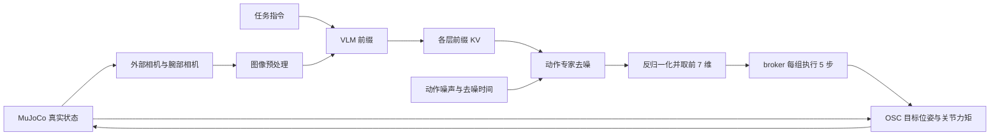

# π0.5-LIBERO：状态条件、权重与仿真执行链

核查日期：2026-11-09（Asia/Shanghai）。仅阅读配置、论文、权重头和控制器代码，
未改动正在运行的评测或生产推理逻辑。

## 结论与适用范围

当前运行的是 `pi05_libero` 配置，加载本地
`/data1/lin/openpi_cache/openpi-assets/checkpoints/pi05_libero_pytorch/model.safetensors`。
不要将它与 `pi0_libero`、π0.5 通用架构或 π0.5 基础模型混为一谈。

π0.5 论文的通用架构输入离散化本体状态；官方发布的 LIBERO 专用权重则使用
`discrete_state_input=False` 的配置微调。这是官方 LIBERO 配方，不是本轮迁移才关闭。
当前策略网络依赖图像和指令预测末端运动命令，底层 OSC 控制器始终使用真实仿真状态执行命令。

## 训练与权重证据

1. π0.5 论文第 5 页明确写明本体状态离散化后作为 text token 输入；附录 E（PDF 第 19 页）
   再次说明 VLM 接收 tokenized proprioception，动作专家接收带噪动作。
2. OpenPI 官方 README 将 `pi05_base` 标为基础模型，将 `pi05_libero` 标为 LIBERO 微调权重。
3. 官方 LIBERO README 明确写道：发布的 `gs://openpi-assets/checkpoints/pi05_libero/`
   权重使用 `pi05_libero` 配置训练。表格标记为 `π0.5 @ 30k (finetuned)`。
4. 官方同名配置设置 `pi05=True, action_horizon=10, discrete_state_input=False`，
   `extra_delta_transform=False`，从 `pi05_base/params` 初始化，微调 30,000 步。
5. 同一训练配置控制训练及推理的输入变换。因此，这份 LIBERO 微调配方没有状态 token，
   并非训练时使用、推理时临时关闭。π0.5 分支也没有 π0 的连续 state token。

基础预训练、后训练与 LIBERO 微调是不同阶段。不能由 LIBERO 配置反推“π0.5 从未学过本体状态”。
公开论文说明通用 π0.5 使用状态，但公开源码/本地文件不提供每个发布权重全部训练批次的日志，
不据此断言每条预训练样本的输入组成。

本地转换权重的 `config.json` 仅保存维度、horizon、backbone 与精度；没有保存状态开关或完整训练履历。
转换脚本本身只写这些字段。safetensors 没有独立 state projection 参数，符合 π0.5 架构；
这不能单独证明有无状态 token，因为状态 token 复用文本 embedding。
本地运行时状态路径的结论由配置、计算图与已有状态扰动实验共同支持。
未重新下载并逐张量比对官方 JAX 权重，不将本地文件名作为权重来源的密码学证明。

## 状态为什么出现在数据里，却不影响本次动作

客户端发送 `observation/state`：末端 xyz（3）、旋转向量（3）、两个手指关节位置（2）。
`LiberoInputs` 保留它，policy 也会归一化、补齐并传递这个字段。
但 `TokenizePrompt(discrete_state_input=False)` 不把它转为 token；
`embed_suffix` 的连续状态 token 仅在 `not self.pi05` 时存在。
后加的状态 AdaRMS MLP 为零输出且未训练，当前开启它也不改变动作。
`extra_delta_transform=False` 也意味着输出后处理不会把传入状态再加到动作上。
因此，数据结构里保留 state、权重资产里有 state 的归一化统计，都不意味着神经网络使用 state。

已有真实权重实验：固定图像、提示词与噪声，将输入 state 整体加 5，动作差异为 0；
见 `data/libero/reflex_fixed_single_frame_20261108/prefix_forensics.json`。

## 模型如何控制机械臂

上层策略从固定外部相机与腕部相机获取视觉信息，结合指令和训练所得的视觉运动规律预测动作。
图像含有机械臂/夹爪及其与物体的相对关系，但这不等于模型显式、准确地恢复了所有关节状态。
遮挡、视觉歧义、相机或机器人变化仍可能造成错误。

低层控制器直接读取 MuJoCo 中的末端位置、旋转矩阵、速度、关节位置、Jacobian 与质量矩阵，
这些精确状态用于执行和反馈控制，不会自动作为模型的条件或前缀 KV 返回给 VLM。

上图描述有效条件；state 字段仍随请求传递，只是在当前配置下不影响动作。

## 七维动作的含义与执行

当前 checkpoint 输出 10 步、内部维度 32 的归一化动作；policy 用 checkpoint 的 action
统计量反归一化，`LiberoOutputs` 取前 7 维。broker 只执行每组前 5 步。

| 维度 | 含义 | OSC/夹爪处理 |
| --- | --- | --- |
| 0–2 | 末端平移命令 | 裁剪至 [-1,1]，各轴乘 0.05 m |
| 3–5 | 末端轴角旋转增量命令 | 裁剪至 [-1,1]，各轴乘 0.5 rad，再构造旋转矩阵 |
| 6 | 夹爪开合命令 | 负数打开，正数闭合；经过 Panda gripper 的内部目标累计与执行器映射 |

这里是 robosuite 1.4.1 的 `OSC_POSE` 默认配置。七维动作不是七个关节角增量。
网络反归一化与控制器缩放是不同步骤，不能混为一次操作。

执行一条动作 a 时，控制器先读取执行当下的真实状态，再构造：

`p_goal = p_actual + 0.05 * clip(a[:3], -1, 1)`

`R_goal = Exp(0.5 * clip(a[3:6], -1, 1)) @ R_actual`

坐标对应当前实现的世界坐标，旋转增量左乘。
例如 `a[:3] = [0.2, 0, 0]` 对应沿世界 x 正方向偏移 1 cm 的目标。
这不是保证实际末端在一步内移动 1 cm；控制器根据位置、姿态、速度误差计算力/力矩，
再通过动力学与 Jacobian 得到关节力矩，MuJoCo 执行后产生下一观测。

控制频率 20 Hz，每个高层动作对应 0.05 秒仿真时间；默认物理步长 0.002 秒，约 25 个物理子步。
新动作仅在第一个子步更新目标，控制器在后续子步继续反馈追踪。
夹爪的 `speed=0.01` 用于内部归一化目标的累计，不能解释为关节实际移动 0.01 m，
也不能把开合命令直接加到两个手指 qpos。

## 与提前两步推理的关系

推理使用 I3，第四/第五步动作在后台请求期间执行；下一组首条动作执行时，OSC 会读取 s5 的
真实位姿，并相对它构造目标。两步动作造成的真实机械臂运动已经体现在控制器当前状态中。
但策略选择动作的视觉依据仍为 I3；控制器不会替模型更新图像中的物体、抓取关系或决策。

broker 已用剩余两步命令预测状态并传给 policy，但当前状态输入路径无效，所以不会改变策略输出。
给输入字段加预测量不能自动使 VLM KV 带上未来状态。
若在动作执行端再次把这两步位移作为偏移加到控制目标上，则可能重复计入已发生的运动。
任何动作重对齐都必须明确所用时间、坐标、动作语义与模型条件，不能直接累计原始动作数字。

启用状态 token 复用已有文本 embedding，不是凭空增加一个随机状态头；
但会改变这份 LIBERO 微调权重的输入分布和前缀长度，不能当作恢复训练时默认行为。
如要评估，应另开配置做状态依赖检查与配对闭环实验。

## π0 与 π0.5 的区别

| 实现/配置 | 状态路径 |
| --- | --- |
| π0 / `pi0_libero` | 连续 state 投影进入动作专家 suffix；旧配方还可能有额外 delta 变换 |
| 通用 π0.5，启用 discrete state | 状态 token 进入 VLM 前缀，动作专家可经 KV 使用 |
| 当前 `pi05_libero` | 禁用状态 token，无 π0 连续状态路径；当前新增状态 MLP 输出为零 |

## 一手来源

官方源码固定于 commit `215abfb217dbac7d5f1273282331b9b1866c0479`。

- [π0.5 论文，第 5 页与附录 E](https://www.physicalintelligence.company/download/pi05.pdf)
- [官方权重清单](https://github.com/Physical-Intelligence/openpi/blob/215abfb217dbac7d5f1273282331b9b1866c0479/README.md)
- [官方 LIBERO 权重训练说明](https://github.com/Physical-Intelligence/openpi/blob/215abfb217dbac7d5f1273282331b9b1866c0479/examples/libero/README.md#results)
- [官方 pi05_libero 训练配置](https://github.com/Physical-Intelligence/openpi/blob/215abfb217dbac7d5f1273282331b9b1866c0479/src/openpi/training/config.py#L744)
- [官方 π0/π0.5 前向代码](https://github.com/Physical-Intelligence/openpi/blob/215abfb217dbac7d5f1273282331b9b1866c0479/src/openpi/models/pi0.py)
- [官方 LIBERO 推理与 env.step](https://github.com/Physical-Intelligence/openpi/blob/215abfb217dbac7d5f1273282331b9b1866c0479/examples/libero/main.py#L133)

本机实际执行链：

- `src/openpi/policies/policy_config.py`、`src/openpi/policies/libero_policy.py`。
- `.venv/lib/python3.11/site-packages/robosuite/controllers/config/osc_pose.json`。
- `.venv/lib/python3.11/site-packages/robosuite/controllers/osc.py` 的 `set_goal` / `run_controller`。
- `.venv/lib/python3.11/site-packages/robosuite/controllers/base_controller.py` 的 `scale_action` / `update`。
- `.venv/lib/python3.11/site-packages/robosuite/utils/control_utils.py` 的目标位置/姿态复合。
- `.venv/lib/python3.11/site-packages/robosuite/environments/base.py` 的 `step`。
- `.venv/lib/python3.11/site-packages/robosuite/models/grippers/panda_gripper.py`。
